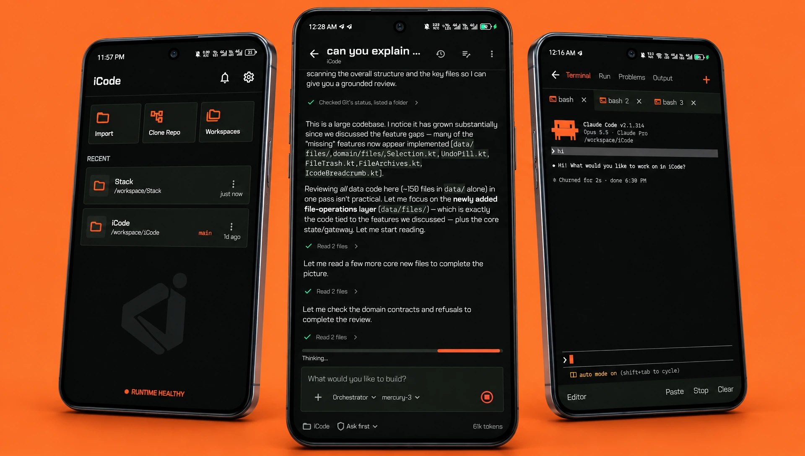

<p align="center">
  
</p>

<h1 align="center">iCode</h1>

<p align="center">
  <b>A phone-first native Android IDE with a Linux runtime, Git, a terminal, language services, and an AI assistant.</b>
</p>

<p align="center">
  <a href="LICENSE"></a>
  
  
  <a href="https://github.com/itzmejanak/iCode/actions/workflows/ci.yml"></a>
  <a href="https://github.com/itzmejanak/iCode/releases"></a>
</p>

<p align="center">
  <a href="https://github.com/itzmejanak/iCode/releases">Download</a> ·
  <a href="docs/README.md">Documentation</a> ·
  <a href="docs/roadmap.md">Roadmap</a> ·
  <a href="https://icodze.vercel.app">Website</a> ·
  <a href="https://github.com/itzmejanak/iCode/issues/new/choose">Report a bug</a>
</p>

## Overview

iCode is a phone-first Kotlin and Jetpack Compose development environment for ARM64 Android devices. Supported tablets currently use the same single-surface phone shell at every width; adaptive tablet and landscape layouts remain [roadmap work](docs/roadmap.md#adaptive-tablet-landscape-foldable-and-multi-window-shell). iCode keeps workspaces in the app's private storage, exposes them through Android's system document provider, and gives the editor, Git, search, terminal, language servers, and assistant one consistent view of those files.

iCode is local-first: workspace editing, local Git operations, search, and terminal execution do not require an iCode account or hosted workspace. Features that inherently use a network do send data outside the device. These include configured Git remotes, AI and speech providers, remote MCP servers, runtime and tool downloads, updates, reports, and opt-in device facts. See [Privacy](PRIVACY.md) for the exact boundaries.

## Current capabilities

- **Workspaces and files:** create, clone, or import a workspace; manage files; recover drafts; detect external changes; and open workspace documents from Android's Files app.
- **Editor and search:** native editing, Markdown and math preview, quick open, find and replace, command palette, ripgrep workspace search, and syntax highlighting from **357 bundled TextMate language and format definitions**. The catalog and per-grammar provenance are documented in [`docs/editor-grammar-provenance.md`](docs/editor-grammar-provenance.md).
- **Language services:** configurable Language Server Protocol clients provide diagnostics, completion, hover, definitions, references, symbols, code actions, formatting, and rename when the selected server supports them.
- **Linux and terminal:** an Ubuntu 24.04.5 ARM64 userspace runs under PRoot without root access. The Termux-based terminal retains sessions across navigation and activity recreation while iCode's Android process remains alive; process death ends them. Users can install compatible ARM64 Linux tools. PRoot is a compatibility layer, not a virtual machine or security boundary.
- **Android development:** optional runtime tools can install the JDK, Android SDK, NDK, CMake, and Ninja needed to build projects. Build and Run uses a project's Gradle wrapper and hands APK installation to Android's package installer.
- **Git:** status, diffs, staging, commits, branches, history, conflicts, fetch, pull, push, SSH and HTTPS authentication, and GPG commit signing.
- **Assistant:** a bring-your-own-provider coding assistant with workspace tools, approval modes, local chat history, attachments, MCP servers, and terminal and language-service integration.
- **Optional phone and voice features:** phone control uses Android accessibility and, when authorized, Shizuku. Speech recognition and synthesis can use Android services or a configured provider.
- **Interface:** dark, light, and AMOLED themes, theme variants, selectable accents, workspace tool navigation, and background-work notifications.

Capabilities in the current source tree may not yet be in the latest public APK, and some device/provider combinations still need acceptance testing. Check the [changelog](CHANGELOG.md), [documentation status](docs/README.md), and [roadmap](docs/roadmap.md) before relying on a capability for production work.

## Requirements

- Android 11 (API 30) or newer
- An ARM64 (`arm64-v8a`) device
- At least 1.5 GiB free for the base Linux runtime, plus space for workspaces and optional toolchains
- Network access when downloading the runtime or tools, or using a configured remote service

## Install

Download an APK and its checksum from [GitHub Releases](https://github.com/itzmejanak/iCode/releases), verify the published SHA-256, and install the APK through Android.

The Linux runtime is a separate, checksum-verified download. iCode requests it when a runtime-backed feature needs it, and you decide whether to begin the download. The APK does not silently download the runtime on first launch. Optional developer tools are installed only when you request or approve them.

Permissions are requested in context and are not all required for ordinary editing:

- notifications and battery-optimization exemption support long-running terminal, build, and assistant work;
- All Files Access supports importing phone folders and assistant access to phone storage;
- microphone access supports voice input;
- accessibility and Shizuku authorization support optional phone control; and
- package-install permission supports Build and Run.

Stable, beta, preview, staging, and debug builds use separate application IDs and data. Published beta and preview builds update only within their own channels. See [Build and release](docs/build-and-release.md#build-types-package-ids-and-channels).

## Build from source

See [Build and release](docs/build-and-release.md#prerequisites) for the complete prerequisite, variant, signing, CI, and release contract. For a local debug build, install these host prerequisites:

- JDK 17
- Android SDK Platform 36 and Build Tools `36.0.0`
- Android NDK `27.0.12077973`
- CMake `3.22.1`
- the `patch` command
- Git with recursively initialized submodules

Set `ANDROID_HOME` or provide the SDK path in `local.properties`, then build:

```bash
git clone --recurse-submodules https://github.com/itzmejanak/iCode.git
cd iCode
git submodule update --init --recursive
./gradlew :app:assembleDebug
```

The APK is written to `app/build/outputs/apk/debug/app-debug.apk`. The native build uses the `third_party/proot` and `third_party/libandroid-shmem` submodules and applies the patches under `third_party/patches/` to build-directory copies.

Website-backed updates, notices, reports, and device-info sharing are disabled when no website URL is configured. To include them in a local build:

```bash
./gradlew :app:assembleDebug -PicodeWebUrl=https://example.invalid
```

## Tests and quality checks

CI runs debug and release JVM unit tests and assembles a debug APK. The repository also has Android tests, shared JVM/device editor tests, lint, architecture guards, release assembly checks, and a device screenshot workflow. See [Contributing](CONTRIBUTING.md#tests-and-quality-gates) for the exact commands and locations.

## Architecture

```text
app/src/main/java/dev/icode/mobile/
├── domain/          immutable state, intents, effects, and rules
├── data/            Android, storage, runtime, Git, assistant, and web implementations
├── ui/              Compose screens plus editor and terminal presentation
├── designsystem/    semantic tokens and shared UI components
├── navigation/      routes and navigation actions
├── ICodeApplication.kt
└── MainActivity.kt
app/src/main/cpp/                    native process/runtime components
app/src/main/assets/runtime/         pinned runtime and tool manifest
app/src/main/assets/textmate/        generated syntax catalog and grammars
third_party/                         native and vendored sources, patches, and assets
tools/                               consistency, import, and capture scripts
docs/                                architecture, product, provenance, and roadmap documents
```

The project currently builds as one `:app` Gradle module. Start with the [documentation index](docs/README.md) and [`docs/architecture.md`](docs/architecture.md).

## Project policies

- [Contributing](CONTRIBUTING.md)
- [Code of Conduct](CODE_OF_CONDUCT.md)
- [Privacy](PRIVACY.md)
- [Security](SECURITY.md)
- [Third-party notices](THIRD_PARTY_NOTICES.md)
- [Changelog](CHANGELOG.md)

## License

iCode is licensed under the [GNU General Public License v3.0](LICENSE). Bundled and downloaded third-party components remain under their respective terms; see [Third-party notices](THIRD_PARTY_NOTICES.md).
