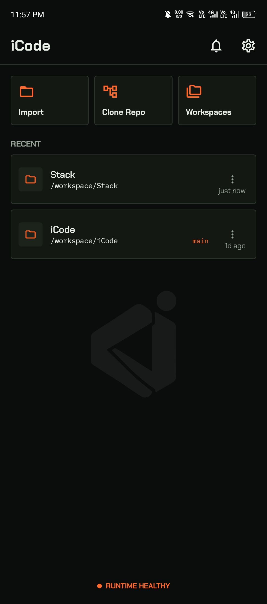
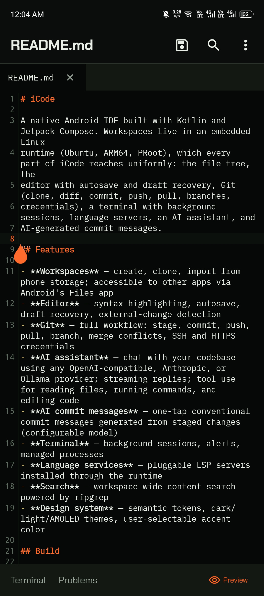
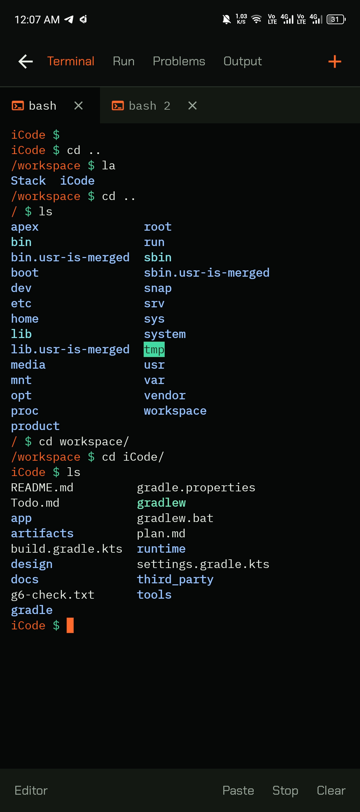
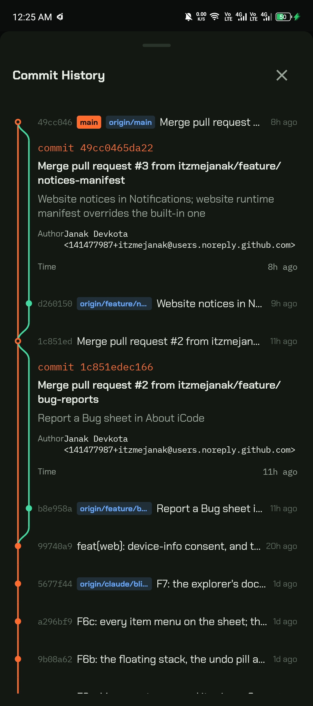
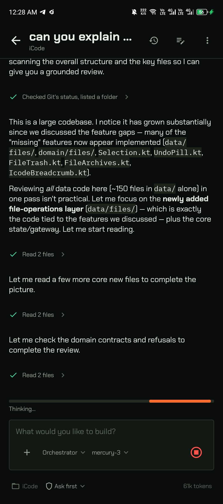

<p align="center">
  
</p>

<h1 align="center">iCode</h1>

<p align="center">
  <b>A native Android IDE with a real Linux runtime, Git, a terminal and an AI assistant.</b>
</p>

<p align="center">
  <a href="LICENSE"></a>
  
  
  <a href="https://github.com/itzmejanak/iCode/actions/workflows/ci.yml"></a>
  <a href="https://github.com/itzmejanak/iCode/releases"></a>
</p>

<p align="center">
  <a href="https://github.com/itzmejanak/iCode/releases">Download</a> ·
  <a href="https://icodze.vercel.app">Website</a> ·
  <a href="https://github.com/itzmejanak/iCode/issues/new/choose">Report a bug</a>
</p>

---

iCode is a native Android development environment built with Kotlin and Jetpack Compose. Your
workspaces live in an embedded Ubuntu 24.04 runtime (ARM64, run through PRoot, no root needed), and
every part of the app works on those files: the file tree, the editor, Git, the terminal, language
servers and iCode's own AI assistant.

It is local-first. Editing, Git and the terminal do not depend on any website or account.

## Screenshots

<p align="center">
  
  
  
  
  
</p>

## Features

**Workspaces and editor**
- Create, clone or import workspaces from phone storage. Other apps can reach them through Android's Files app.
- Editor with syntax highlighting from bundled TextMate grammars for 31 languages and file formats, plus autosave, draft recovery and external-change detection.
- Quick open, command palette, find in file, and workspace-wide search powered by ripgrep.

**Terminal and Linux runtime**
- Ubuntu 24.04.5 base rootfs, installed on first launch and checked against a SHA-256.
- Terminal with background sessions, alerts and managed processes.
- Install any compatible CLI, compiler or language server. Command-line agents such as Claude Code and opencode run inside the terminal.
- Language services through pluggable LSP servers installed in the runtime.

**Git**
- Clone, stage, diff, commit, push, pull, branches, history and merge conflicts.
- SSH and HTTPS credentials, plus GPG commit signing.
- One-tap AI commit messages generated from staged changes.

**AI assistant**
- iCode's own assistant, built on Koog. It can read files, run commands and edit code in your workspace.
- You choose the provider and bring your own key. Clients are included for OpenAI-compatible, Anthropic, Google, OpenRouter and Ollama endpoints.
- Several assistant modes, and actions that need your approval before they run.
- Phone control (opt-in): from a bubble over any app, the assistant reads the screen and acts in other apps, asking before each one; Shizuku makes setup one tap.
- Voice both ways: speak to it and hear its answers as they are written — heard by Android's own speech recognition, or by AssemblyAI, OpenAI, Deepgram, Google Cloud or a server of your own, and read aloud by Android's text-to-speech or by AssemblyAI, OpenAI, Deepgram, Google Cloud, Azure AI Speech, ElevenLabs or a server of your own, each chosen separately.

**Design**
- Semantic design tokens, dark, light and AMOLED themes, and a user-selectable accent colour.

## Requirements

- Android 11 (API 30) or newer
- An ARM64 (`arm64-v8a`) device
- About 1.5 GB of free space for the Linux runtime

## Install

Download the APK from [Releases](https://github.com/itzmejanak/iCode/releases), compare it with the
published SHA-256, and install it. On first launch, iCode installs its Linux runtime. It then offers
optional permissions (notifications, battery) one at a time through Android's own dialogs.

Stable is the original icon. Beta and preview are pre-releases, each with its own icon, and install
beside stable as separate apps with their own data; each updates only from its own channel
([docs/environments-plan.md](docs/environments-plan.md)).

## Build from source

Requirements: JDK 17, Android SDK 36 and NDK 27.0.12077973.

```bash
git clone --recurse-submodules https://github.com/itzmejanak/iCode.git
cd iCode
./gradlew :app:assembleDebug
```

The APK is written to `app/build/outputs/apk/debug/app-debug.apk`.

`third_party/proot` and `third_party/libandroid-shmem` are Git submodules. If you cloned without
them, run `git submodule update --init`.

Website features (update check, notices, device info) are off unless the build sets an address:
`./gradlew :app:assembleDebug -PicodeWebUrl=https://…`.

## Tests

```bash
./gradlew test
```

## Privacy

iCode has no account and no sign-in. Device info is shared only if you opt in during onboarding,
and it never includes workspace content, Git remotes, credentials, terminal output or assistant
prompts. You can turn it off at any time in Settings › Application. See [PRIVACY.md](PRIVACY.md).

## Project structure

```text
app/src/main/java/dev/icode/mobile/
├── MainActivity.kt       # Single activity host
├── designsystem/         # Semantic tokens (colors, type, metrics, shapes) + shared UI kit
├── domain/               # Immutable state, intent/effect contract, rules
├── data/                 # Android implementations
│   ├── assistant/        # AI assistant engine, Koog integration, tools, chat store
│   ├── git/              # Git operations, auth, transfers, conflicts
│   ├── runtime/          # Linux runtime, terminal, package installer
│   ├── workspace/        # Gateway, session, lifecycle, documents, tree
│   ├── search/           # Ripgrep-backed content search
│   ├── settings/         # Preferences
│   └── ...               # Language services, notices, storage, IO, logging
├── navigation/           # Routes and navigation actions
└── ui/                   # Compose screens
app/src/main/cpp/         # Native runtime loader (PRoot, talloc, libandroid-shmem)
third_party/              # Vendored and submodule native sources
docs/                     # Product, architecture and feature plans
```

Start with [docs/architecture.md](docs/architecture.md) and [docs/prd.md](docs/prd.md).

## Contributing

Bug reports, ideas and pull requests are welcome. Read [CONTRIBUTING.md](CONTRIBUTING.md) first, and
follow the [Code of Conduct](CODE_OF_CONDUCT.md). Report security issues privately, as described in
[SECURITY.md](SECURITY.md).

## License

iCode is licensed under the [GNU General Public License v3.0](LICENSE). Bundled third-party
components keep their own licences. See [THIRD_PARTY_NOTICES.md](THIRD_PARTY_NOTICES.md).
