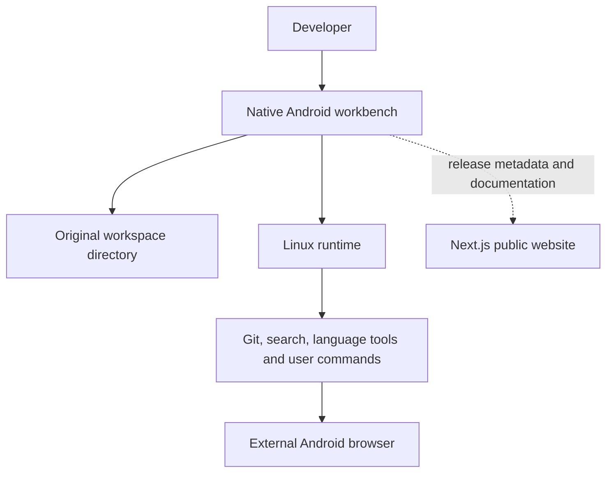
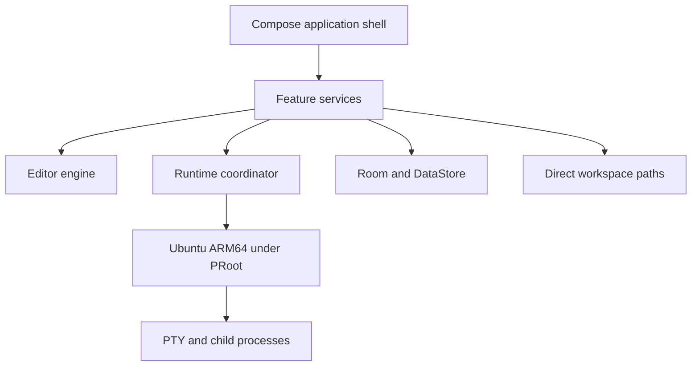

# Native Mobile Development Workbench — Architecture Design

**Version:** 1.0  
**Status:** Foundation contract  
**Product name:** iCode  
**Platforms:** Android phones and tablets  

## 1. Purpose

This document defines the durable technical foundation for a native Android development workbench. It describes system boundaries, component ownership, data flow, runtime behavior, persistence, integration contracts, and non-negotiable architectural decisions.

It intentionally does not define delivery order, milestones, or task groups. Those belong in a separate implementation plan derived from this architecture, the layout specification, and the user stories.

## 2. Product Definition

The product is a native Android development environment that lets a developer:

- open an existing directory without copying it;
- edit the original files directly;
- inspect, stage, commit, pull, and push Git changes;
- search and replace across a workspace;
- use language intelligence through the Language Server Protocol;
- run arbitrary commands in a persistent Linux environment;
- install any compatible CLI, compiler, language server, or AI agent;
- run local development servers and open their URLs in the device browser;
- continue eligible processes while the application is backgrounded.

The product is not a VS Code distribution, a browser-hosted IDE, an extension marketplace, or an agent-specific client.

## 3. Architectural Goals

1. **Native ownership of the experience** — navigation, layout, editor surfaces, Git views, terminal panels, settings, touch behavior, and adaptive layouts are controlled by the Android application.
2. **Original files as the source of truth** — an opened directory is never silently copied into application storage.
3. **Tool neutrality** — the runtime executes user-selected tools without maintaining a catalogue of supported agents or providers.
4. **Open protocol reuse** — language intelligence and debugging build on established protocols rather than editor-specific integrations.
5. **Clear module boundaries** — features communicate through stable interfaces and do not reach into one another's storage or UI internals.
6. **Local-first operation** — editing, Git, search, terminal, and runtime execution do not require an account or hosted backend.
7. **Community maintainability** — contributors can understand feature ownership, test changes in isolation, and add native capabilities without modifying a monolithic application class.
8. **Minimal platform policy** — the platform does not impose per-command approvals, tool allowlists, or artificial restrictions on processes launched by the user.
9. **Recoverable state** — application and runtime interruption must not silently lose document state or misrepresent stopped processes.
10. **Small permanent surface** — foundational contracts remain stable while future capabilities can be added behind them.

## 4. Explicit Non-Goals

The architecture does not include:

- Code OSS, OpenVSCode Server, Monaco, or a browser-rendered workbench;
- an IDE WebView or a local HTTP server used to render the application UI;
- VS Code extension execution, `.vsix` installation, an extension host, or an extension marketplace;
- named integrations for Codex, Claude Code, Gemini CLI, OpenCode, or any other agent;
- an internal web browser, preview panel, port dashboard, or preview proxy;
- mandatory accounts, cloud workspaces, or remote execution;
- a platform-specific package format for developer tools;
- a per-command security broker or agent capability sandbox;
- root access or access to other applications' private Android directories;
- a copy-on-open project import flow;
- ForgeKit packages, runtime contracts, navigation, product modules, or branding.

ForgeKit's color and typography choices may influence the default visual theme. That visual reuse does not create a code, runtime, data, or product dependency between the projects.

## 5. Architectural Principles

### 5.1 Native-first

Jetpack Compose owns the application shell and all product-level screens. The code editor is a native Android view exposed through an internal editor interface and hosted within Compose. No product capability depends on browser DOM behavior.

### 5.2 Modular monolith

The Android application is deployed as one application and organized into cohesive modules. Network-style internal services, microservices, and duplicated data stores are avoided. Module boundaries exist for maintainability and testability, not distribution.

### 5.3 Commands are runtime capabilities

Git, `ripgrep`, language servers, compilers, formatters, test runners, development servers, and AI agents are ordinary processes in the Linux runtime. The application may present native workflows around stable command interfaces, but it does not redefine those tools.

### 5.4 Protocols over product adapters

Generic protocols and process contracts take priority:

- Language Server Protocol for code intelligence;
- Debug Adapter Protocol for debugger communication when debugging is introduced;
- PTY streams for interactive processes;
- Git porcelain and diff formats for source-control state;
- ordinary files and directories for workspaces;
- Android intents for opening external URLs.

### 5.5 Direct data ownership

The user owns workspace data. The application owns only its runtime, configuration, caches, indexes, session metadata, and recovery buffers.

### 5.6 UI and domain separation

Compose screens render immutable view state and dispatch intents. Domain services perform file, process, Git, search, language, and persistence work. UI components do not launch shell commands or read the filesystem directly.

## 6. System Context



The Android workbench and Linux runtime form the local product. The Next.js website is a distribution and information surface; it is not on the editing or execution path.

## 7. High-Level Runtime Topology



### 7.1 Android process

The Android application owns:

- Compose UI and navigation;
- native editor hosting;
- workspace discovery and direct file access;
- document models and recovery buffers;
- runtime lifecycle and foreground-service integration;
- terminal rendering and PTY session coordination;
- Git, search, and language-service orchestration;
- session, preference, and recent-workspace persistence;
- Android permissions, notifications, and external-browser intents.

### 7.2 Linux runtime

The runtime is an Ubuntu ARM64 root filesystem executed through PRoot. It owns:

- the interactive shell;
- user home directory;
- Git and SSH clients;
- package managers;
- `ripgrep` and other command-line utilities;
- language servers and debug adapters installed by the user;
- compilers, interpreters, build systems, test runners, and development servers;
- AI agents and automation tools installed by the user;
- child-process environment and signals.

PRoot is not treated as a security boundary or virtual machine. It provides a compatible Linux userspace and path mapping within the Android application sandbox.

### 7.3 Public website

The Next.js application may provide:

- landing pages;
- product documentation;
- downloads and release notes;
- application and runtime release manifests;
- compatibility notes;
- contribution documentation.

The native workbench remains useful when this website is unavailable. Accounts, synchronization, and cloud execution are not architectural requirements.

## 8. Android Application Modules

```text
apps/android/
├── app/                    # Composition root, activity, application lifecycle
├── design-system/          # Semantic colors, type, spacing, shapes, components
├── navigation/             # Route model, adaptive shell, back-stack ownership
├── workspace/              # Open/create/clone, recents, workspace state
├── files/                  # Direct-path access, tree model, file operations
├── editor-api/             # Stable editor engine and document contracts
├── editor-native/          # Native editor engine implementation
├── search/                 # Quick open, content search, replacement
├── source-control/         # Git status, diff, staging, branches, synchronization
├── terminal/               # Terminal renderer, sessions, extra keys
├── language/               # LSP client, language-service lifecycle, diagnostics
├── problems/               # Aggregated diagnostics and navigation
├── runtime/                # Bootstrap, PRoot lifecycle, processes, PTY bridge
├── settings/               # Hierarchical settings and validation
├── sessions/               # Restore, recovery, editor and panel state
├── persistence/            # Room, DataStore, migrations, repositories
└── platform/               # Permissions, notifications, intents, Android adapters

apps/web/                   # Next.js public website
runtime/bootstrap/          # Versioned runtime assets and manifests
docs/                       # Product, contributor and protocol documentation
tests/                      # Cross-module integration and device tests
```

Modules may initially be Gradle source sets where separate Gradle modules would add noise. The dependency direction remains enforced even when physical extraction happens later.

## 9. Dependency Rules

1. Feature UI depends on feature domain contracts, never on runtime implementation classes.
2. `editor-native` implements `editor-api`; other features depend only on `editor-api`.
3. Git, search, language, and terminal features use the runtime process contract rather than constructing PRoot commands independently.
4. Persistence is accessed through repositories owned by the relevant feature.
5. Platform adapters implement interfaces defined by the consuming domain.
6. The design system depends on no feature module.
7. The application composition root is the only location allowed to wire concrete implementations together.
8. The public website shares release schemas through generated or explicitly versioned contracts, not by importing Android feature code.

## 10. Core Contracts

### 10.1 Workspace contract

A workspace represents one user-selected root directory and contains:

- stable internal workspace identifier;
- canonical Android path;
- runtime-visible path, normally `/workspace`;
- display name;
- last-opened time;
- Git repository discovery result;
- active language-service configurations;
- session reference.

The workspace record does not contain a copy of project files.

Multiple roots are not assumed by the foundation. They can be introduced later without changing the direct-path ownership rule.

### 10.2 File service contract

The file service provides:

- directory enumeration;
- metadata and type inspection;
- streaming reads and atomic writes where supported;
- create, rename, move, copy, and delete;
- path normalization and workspace-boundary awareness;
- external-change observation;
- binary and large-file detection;
- encoding and line-ending preservation.

All destructive operations resolve a concrete path before execution. The service never performs hidden workspace duplication.

### 10.3 Document contract

An open document tracks:

- canonical path and workspace identity;
- decoded text and encoding;
- line-ending convention;
- saved revision fingerprint;
- current in-memory revision;
- dirty state;
- cursor, selection, folds, and scroll position;
- diagnostics and Git decorations;
- recovery-buffer state;
- external-change state.

A save writes to the original file. If the on-disk revision changed after the document was opened, the user receives reload, compare, and overwrite choices.

### 10.4 Editor engine contract

The editor engine owns text interaction and rendering. It supports:

- open and close document models;
- selections, cursor movement, edits, and undo/redo;
- syntax tokens and semantic decorations;
- line, diagnostic, and Git gutter decorations;
- completion, hover, signature, and code-action presentation;
- find, replace, go-to-line, folding, indentation, and word wrapping;
- state capture and restoration;
- touch, software keyboard, and hardware keyboard input.

The selected implementation is replaceable. Sora Editor is a candidate implementation, not a cross-module dependency.

### 10.5 Process contract

The runtime exposes one process API for non-interactive and PTY-backed commands:

- executable, arguments, working directory, and environment;
- stdout, stderr, exit code, and structured lifecycle events;
- PTY rows, columns, input, resize, and signal operations;
- cancellation and termination;
- foreground-service ownership for eligible long-running work;
- stable process and session identifiers.

Feature modules do not parse terminal screen output when a stable command format exists.

### 10.6 Git contract

Git is invoked through the runtime and remains the repository authority. The source-control service provides:

- repository discovery;
- working-tree, index, conflict, branch, upstream, ahead, and behind state;
- staged and unstaged diffs;
- per-file stage, unstage, discard, and resolve operations;
- commit, fetch, pull, push, branch, and switch operations;
- operation progress and errors;
- status refresh invalidation.

Machine-readable status uses Git porcelain output with NUL-delimited paths. Diffs use Git-generated patches. Filenames are never parsed from human-oriented output.

### 10.7 Search contract

Search is separated into:

- **Quick Open:** ranked workspace file and path discovery;
- **Search in Files:** content search, filters, regular expressions, result grouping, and replacement.

`ripgrep` is the primary content-search engine. Results are streamed, cancellable, bounded, and decoded without blocking the UI thread.

### 10.8 Language-service contract

The language module is a generic LSP client and supervisor. A language-service configuration contains:

- language identifier;
- matching filenames or extensions;
- executable and arguments;
- environment variables;
- workspace-root markers;
- initialization options;
- restart policy.

The user installs language servers through ordinary package managers and may configure any compatible command. The platform does not require a hard-coded provider class for each language.

Supported LSP capability surfaces include completion, hover, signatures, definitions, references, symbols, rename, formatting, diagnostics, and code actions. The UI advertises only capabilities reported by the connected server.

### 10.9 Terminal contract

The terminal feature provides:

- multiple PTY sessions;
- workspace-aware starting directories;
- VT/ANSI rendering and scrollback;
- input, selection, copy, paste, and configurable extra keys;
- URL recognition and Android external-browser dispatch;
- session lifecycle and stopped-process reporting.

Terminal history and tool configuration belong to the user's runtime home. The application does not interpret commands to identify particular AI agents.

### 10.10 Settings contract

Settings are registered under hierarchical categories. Each setting defines:

- stable key;
- category and optional subcategory;
- type and default;
- validation rules;
- scope: application or workspace;
- whether a restart or runtime restart is required;
- human-readable title and description.

Unknown future settings can be added under existing categories without adding a new top-level destination.

## 11. Primary Data Flows

### 11.1 Open an existing directory

1. The user selects Open Folder.
2. Android requests All Files Access if it has not been granted.
3. The application resolves and validates the selected direct path.
4. A workspace record stores the path and display metadata.
5. The runtime maps the directory to `/workspace`.
6. File, Git, search, and language services initialize lazily.
7. The previous session for that workspace is restored when available.

No project files are copied.

### 11.2 Edit and save

1. The file service reads the original file.
2. The document model records a saved revision fingerprint.
3. The editor updates the in-memory revision.
4. Recovery state is persisted while the document is dirty.
5. Save verifies that the disk revision has not unexpectedly changed.
6. The original path is written.
7. Git, diagnostics, search indexes, and open views receive invalidation events.
8. The recovery buffer is cleared after the saved state is durable.

### 11.3 Refresh Git changes

1. File saves and explicit Git operations invalidate repository status.
2. The Git service debounces refresh work.
3. Stable porcelain output is parsed off the UI thread.
4. A repository snapshot updates Explorer badges and the Source Control view.
5. Diffs are fetched only when required by an open diff view or gutter decoration.

### 11.4 Language intelligence

1. A document matches a configured language service.
2. The supervisor starts or reuses the server process.
3. Document open/change/save notifications are sent over JSON-RPC.
4. Diagnostics and requested language results update feature state.
5. The editor renders only capabilities supplied by the server.
6. A crashed server is reported and may be restarted according to its configuration.

### 11.5 External browser

1. A terminal or output surface recognizes an HTTP or HTTPS URL.
2. The user activates the URL.
3. The application sends an Android `ACTION_VIEW` intent.
4. The user's chosen browser opens the URL.

The application does not render the destination internally.

## 12. Filesystem and Storage Model

| Data | Location | Ownership | Persistence |
|---|---|---|---|
| Workspace files | User-selected shared-storage path | User | Survives application removal |
| Runtime root filesystem | App-private storage | Application/user runtime | Survives normal app updates |
| Runtime home and installed tools | App-private runtime storage | User | Survives restart and normal updates |
| Extensions | Not applicable | — | — |
| Workspace metadata | Room database | Application | Removed with application data |
| Preferences | DataStore | Application/user | Removed with application data |
| Dirty-document recovery | App-private recovery store | Application/user | Cleared after durable save or explicit discard |
| Search and syntax caches | App-private cache | Application | Rebuildable |
| Project Git data | Inside original repository | User | Follows workspace ownership |

Normal application updates do not reset the runtime. A repair or reset action must state exactly which runtime data will be replaced or preserved before execution.

## 13. Android Filesystem Boundary

The application requests `MANAGE_EXTERNAL_STORAGE` because broad direct-path access is a core function. The user grants this through Android system settings.

After approval, the application may access ordinary shared-storage paths, supported removable media, and USB storage exposed by Android. It still cannot access:

- another application's private internal data;
- Android-protected application directories denied by the operating system;
- the root-only Android filesystem on an unrooted device;
- a filesystem that is read-only or unavailable.

The UI must describe these limits accurately. The architecture does not add Storage Access Framework trees as the primary workspace model.

## 14. Runtime Lifecycle

### 14.1 Installation

The application verifies the bundled or downloaded runtime manifest, available storage, architecture, and checksums before extraction. Installation is resumable or restartable and never reports readiness before health checks pass.

### 14.2 Start

The runtime coordinator starts one application-owned runtime and exposes its readiness as state. Feature modules wait on that state rather than attempting independent bootstrap operations.

### 14.3 Background work

Interactive or long-running processes that must continue when the UI is not visible are owned by a foreground service with an Android notification. Background execution remains subject to Android and device-vendor process management.

### 14.4 Stop and process death

The UI distinguishes running, exited, failed, and lost processes. After process death, the application restores workspace and document state but does not pretend that non-running commands resumed.

### 14.5 Update and repair

Application updates preserve workspace metadata, settings, runtime home, and installed tools. Runtime updates use explicit versioning. Repair and reset are separate actions with distinct consequences and confirmation text.

## 15. Git Architecture

### 15.1 State model

Repository state distinguishes:

- staged, unstaged, untracked, ignored, renamed, deleted, and conflicted paths;
- current branch or detached head;
- upstream branch;
- ahead and behind counts;
- in-progress merge, rebase, cherry-pick, or revert where Git exposes it.

### 15.2 Diff model

The diff parser produces files, hunks, and lines with stable old/new coordinates. That model supports:

- inline and side-by-side diff presentation;
- editor gutter decorations;
- previous/next change navigation;
- staged and unstaged comparisons;
- later hunk-level actions without changing the repository-state contract.

### 15.3 Credentials

HTTPS credential helpers, SSH keys, agent sockets, and command-line authentication remain Git/runtime concerns. The application may expose status and errors but does not require a proprietary Git account system.

## 16. Language Architecture

Syntax highlighting and language intelligence are separate:

- TextMate or Tree-sitter supplies lexical and structural highlighting;
- LSP supplies project-aware intelligence;
- the editor engine renders results;
- the language supervisor owns server processes and protocol state.

This separation allows useful editing before a language server is installed and prevents the editor renderer from owning language-specific behavior.

## 17. Session and Recovery Architecture

Each workspace session may persist:

- open document paths and ordering;
- selected document;
- cursor, selection, folds, and scroll state;
- drawer, sidebar, and bottom-panel state;
- terminal session metadata;
- search queries and filters where appropriate;
- unsaved recovery buffers;
- last known workspace and repository state timestamps.

Recovery buffers are versioned independently of normal workspace files. The user chooses whether to restore or discard recovered text when it conflicts with a newer on-disk file.

## 18. State Management

Each feature exposes a state holder with unidirectional data flow:

```text
User intent → feature coordinator → domain service → result/event → immutable UI state
```

Cross-feature updates use typed application events or shared domain repositories. A global view model containing every feature is prohibited.

Long-running operations expose explicit states such as idle, queued, running, succeeded, failed, and cancelled. Screens must not infer process state from button clicks or temporary navigation state.

## 19. Performance Requirements

- Filesystem, Git, search, decoding, and protocol work never block the main thread.
- Workspace trees load incrementally and do not recursively enumerate every directory at launch.
- Git status refreshes are debounced and cancellable.
- Diffs and file contents are loaded on demand.
- Search results stream in bounded batches.
- Language servers start only for relevant open documents or explicit user actions.
- Large files use protective limits for highlighting, diagnostics, diff calculation, and recovery buffering.
- Editor state is saved incrementally rather than serialized as one large application snapshot.
- The runtime is not restarted when switching between workspaces unless its health requires it.

## 20. Failure Handling

| Failure | Required behavior |
|---|---|
| Permission denied | Explain the inaccessible path and offer the relevant Android settings action |
| Workspace removed or unmounted | Preserve session metadata, stop writes, and offer retry or workspace removal |
| External file changed | Offer reload, compare, or explicit overwrite when local text is dirty |
| Runtime unavailable | Keep file browsing and safe native state available; expose repair diagnostics |
| Child process exits | Show exit status and retain readable output |
| Language server crashes | Retain the document, clear stale requests, report failure, and allow restart |
| Git command fails | Preserve repository state and show the exact actionable error without claiming success |
| Low storage | Block unsafe writes or runtime extraction before partial corruption |
| Android kills the process | Restore documents and UI state; report terminal processes as stopped unless verified alive |
| Database migration fails | Prevent destructive fallback and expose recoverable diagnostics |

## 21. Security Baseline

Security remains small and practical:

- the user explicitly grants Android All Files Access;
- workspace and runtime commands remain inside Android's application permissions;
- application-owned credentials use Android-provided secure storage where the application controls them;
- CLI credentials remain in the runtime locations expected by those tools;
- runtime archives and release metadata are checksum-verified and signed where distribution supports signing;
- application-internal services do not listen on the LAN;
- project development servers are started only by user commands and follow their own bind configuration;
- logs avoid exposing secrets where the platform itself formats structured data.

The platform does not inspect or approve each shell command. User-installed processes have the same runtime and accessible-filesystem capability as the terminal session that launches them.

## 22. Observability

Local diagnostics include:

- application and runtime version;
- runtime health checks;
- storage availability;
- active process summaries;
- recent process exits;
- language-server lifecycle events;
- Git command failures;
- permission and path-resolution failures;
- sanitized application logs exportable by the user.

Telemetry is not required for core operation. Any future telemetry must be separately documented, disabled without breaking the product, and avoid workspace content.

## 23. Testing Strategy

### 23.1 Unit tests

- document revision and dirty-state transitions;
- path normalization and workspace boundaries;
- Git porcelain and patch parsing;
- LSP message correlation and capability handling;
- settings validation;
- session serialization and recovery decisions;
- search-result parsing;
- navigation state.

### 23.2 Integration tests

- open, edit, save, and externally modify real files;
- map an Android path into the runtime and verify bidirectional changes;
- start, interact with, resize, and terminate PTY processes;
- exercise Git status, diff, stage, commit, branch, and conflict fixtures;
- start a test language server and validate diagnostics and completion;
- kill and restart application/runtime components and verify recovery.

### 23.3 Device tests

- software keyboard and hardware keyboard behavior;
- touch selection and scrolling;
- phone, foldable, and tablet layouts;
- rotation and multi-window state;
- foreground service behavior;
- removable-storage removal;
- external browser dispatch;
- low-memory process recreation.

## 24. Community Contribution Model

Community contributions are made to the product source tree rather than installed as runtime IDE extensions. Each feature contribution must:

- declare its owning module;
- use existing domain contracts or propose a versioned contract change;
- register routes and settings through the established registries;
- avoid introducing a new top-level navigation destination when an existing hierarchy fits;
- include unit or integration coverage for parsing and state transitions;
- document any new runtime dependency and installation impact;
- preserve direct workspace ownership and tool neutrality.

This model keeps the application open to contributors without creating an unbounded executable extension system.

## 25. Architectural Decisions

| Decision | Chosen direction | Reason |
|---|---|---|
| Product UI | Native Compose | Full control over touch, hierarchy, adaptive layout, and accessibility |
| Editor | Replaceable native engine | Avoid WebView dependency and contain third-party editor risk |
| Workbench | Product-owned native features | Avoid maintaining a desktop workbench fork |
| Extensibility | CLI tools and open protocols | Preserve user capability without an extension runtime |
| Workspace access | Direct filesystem paths | Edit original files and keep normal tool compatibility |
| Runtime | Ubuntu ARM64 under PRoot | Provide familiar Linux tooling without device root |
| Source control | Git CLI with stable machine output | Preserve complete Git behavior and avoid reimplementation |
| Search | `ripgrep` process | Reuse a proven fast search engine |
| Language intelligence | Generic LSP client | Avoid per-language application adapters |
| Debugging | DAP-compatible future surface | Keep debugger implementation independent from individual languages |
| Browser output | Android external browser | Avoid duplicating an existing device capability |
| Hosted surface | Independent Next.js website | Keep distribution and documentation outside the local execution path |
| Internal structure | Modular monolith | Balance clear ownership with operational simplicity |

## 26. Invariants

The following rules may not be violated without a new architecture decision:

1. Opening a directory does not copy it.
2. Saving writes to the original selected path.
3. The native UI does not depend on a browser-rendered workbench.
4. The product does not maintain a list of supported AI agents.
5. User-installed commands execute through the same runtime contract as the terminal.
6. Core editing and source-control workflows do not require a hosted account.
7. Git remains repository authority.
8. Language-specific intelligence remains outside the editor engine.
9. Feature modules do not bypass runtime, file, or persistence contracts.
10. Future features extend the hierarchy rather than crowding the root navigation.

## 27. Glossary

| Term | Meaning |
|---|---|
| Workbench | The complete native editing environment, including editor, files, Git, search, terminal, and diagnostics |
| Workspace | One user-selected root directory opened directly from Android-accessible storage |
| Runtime | The application-owned Ubuntu ARM64 environment executed through PRoot |
| Editor engine | Replaceable native component responsible for text interaction and rendering |
| Language service | A user-installed process communicating with the application through LSP |
| Recovery buffer | App-private copy of unsaved document text used only for interruption recovery |
| Source Control | The native Git workflow and repository state presentation |
| External browser | The user's installed Android browser opened through a system intent |
