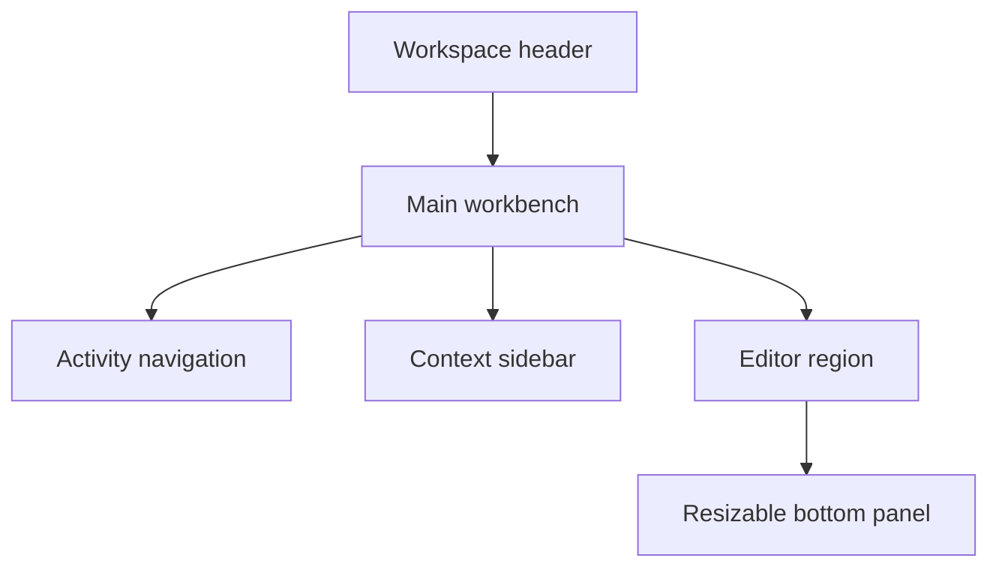

# Native Mobile Development Workbench — Layout and Interaction Design

**Version:** 1.0  
**Status:** Interface contract  
**Product name:** iCode  

## 1. Purpose

This document defines the information architecture, adaptive layout system, navigation behavior, visual language, interaction patterns, and screen responsibilities for the native Android workbench.

It defines a scalable layout foundation rather than a closed list of every future feature. New capabilities must fit the route, panel, category, and detail patterns described here. Delivery order and implementation tasks are intentionally defined elsewhere.

## 2. Experience Direction

The product should feel like a focused professional tool built specifically for Android:

- the editor is the dominant workspace surface;
- supporting tools remain reachable without becoming permanent clutter;
- phones show one primary task at a time;
- tablets use persistent panes where width creates genuine value;
- navigation preserves hierarchy and context;
- status is communicated through text, icons, and restrained color;
- visual density supports coding without becoming a miniature desktop interface;
- touch, software keyboard, stylus, mouse, trackpad, and hardware keyboard are first-class inputs.

## 3. Layout Principles

### 3.1 Editor first

Once a workspace is open, the editor receives the largest available region. Explorer, Search, Source Control, Terminal, Problems, and Settings are supporting surfaces.

### 3.2 Small root navigation

Future features must not create a new bottom tab by default. They register under an existing category, tool surface, list, detail page, command, or settings route.

### 3.3 Hierarchy over accumulation

Configuration follows:

```text
Category → List → Item → Detail
```

For example:

```text
Settings → Languages → Language services → Service details
```

The same route hierarchy renders as pushed pages on compact devices and list-detail panes on wider devices.

### 3.4 Contextual tools

Actions appear near the object they affect. File operations belong in Explorer context actions, staging belongs beside Git changes, and language-server restart belongs on language-service details.

### 3.5 Progressive disclosure

Routine actions are visible. Advanced facts and infrequent controls are one level deeper. Runtime paths, initialization options, and diagnostics do not compete with open, edit, save, search, and commit actions.

### 3.6 No duplicate product surfaces

The same capability must not exist as separate unrelated pages. There is one Source Control model, one terminal system, one settings hierarchy, and one workspace state.

### 3.7 Honest states

Loading, empty, error, stopped, read-only, dirty, conflicted, and disconnected states are explicitly designed. The interface never uses fake data to make an empty page look complete.

## 4. Visual Language

The default visual direction takes inspiration from ForgeKit's successful charcoal, ember, amber, green, Chakra Petch, and IBM Plex Mono combination. The new product owns its design tokens and components independently.

The default theme is not a permanent dark-only restriction. Semantic tokens allow additional themes without feature-level color changes.

### 4.1 Default palette

| Token | Default value | Purpose |
|---|---:|---|
| `background` | `#0A0D0B` | Main application canvas |
| `background.deep` | `#060807` | Deep editor and terminal ground |
| `surface` | `#131812` | Cards, drawers, sidebars |
| `surface.elevated` | `#1C231B` | Menus, dialogs, selected elevated regions |
| `surface.track` | `#232B22` | Tracks and inactive fills |
| `outline` | `#2A332A` | Dividers and boundaries |
| `accent.primary` | `#FF6B2C` | Primary action and active focus |
| `accent.amber` | `#FFC24B` | Warning and changed state |
| `accent.green` | `#43D9A3` | Success, added state, healthy runtime |
| `accent.blue` | `#6AA9FF` | Informational and running state |
| `status.error` | `#FF5449` | Error, deleted state, failure |
| `text.primary` | `#E9EFE7` | Primary content |
| `text.secondary` | `#9AA69A` | Supporting content |
| `text.muted` | `#5F6C60` | Disabled and low-emphasis metadata |

### 4.2 Semantic color rules

- Ember identifies the active primary action or focused control; it is not used decoratively everywhere.
- Green identifies success, healthy state, and added Git lines.
- Amber identifies warning, attention, and modified Git lines.
- Red identifies errors, deletion, destructive action, and unresolved conflicts.
- Blue identifies informational or running state.
- State never depends on color alone; icons, labels, or patterns accompany it.

### 4.3 Typography

| Role | Typeface | Use |
|---|---|---|
| Display and section title | Chakra Petch | Product identity and major page headings |
| Controls and navigation labels | Chakra Petch | Buttons, tabs, compact labels |
| Code | IBM Plex Mono | Editor default and code samples |
| Terminal | IBM Plex Mono | PTY rendering |
| Paths, Git refs, process state | IBM Plex Mono | Technical metadata |
| Long descriptions | System sans or accessible body face | Readability at mobile sizes |

Users can configure editor and terminal fonts independently. System font scaling must not remove access to primary actions.

### 4.4 Shape and density

- Cards and modal surfaces use restrained rounded corners.
- Editor, terminal, diff, and dense tree rows use minimal decoration.
- Touch targets remain at least 48 dp even when the visual icon is smaller.
- Dense lists preserve a clear selected state and comfortable row height.
- Dividers and background contrast establish hierarchy before shadows.

### 4.5 Spacing scale

| Token | Value | Use |
|---|---:|---|
| `space.1` | 4 dp | Icon-label and micro spacing |
| `space.2` | 8 dp | Compact internal spacing |
| `space.3` | 12 dp | Row and control spacing |
| `space.4` | 16 dp | Card and panel padding |
| `space.5` | 20 dp | Page gutter on compact screens |
| `space.6` | 24 dp | Section separation |

Code and terminal surfaces may use tighter internal metrics where touch targets are not involved.

## 5. Adaptive Width Classes

### 5.1 Compact

Typical phones and narrow split-screen windows.

- one dominant content region;
- tool surfaces use a drawer, sheet, or pushed route;
- editor tabs scroll horizontally;
- bottom panel expands over part of the editor;
- detail pages replace their parent list and preserve back navigation;
- inline Git diff is the default.

### 5.2 Medium

Large phones in landscape, foldables, and small tablets.

- a compact activity rail may remain visible;
- one sidebar can coexist with the editor;
- tool panels are resizable;
- list-detail settings may appear when width is sufficient;
- diff can switch between inline and side-by-side.

### 5.3 Expanded

Tablets, desktop mode, and wide multi-window layouts.

- activity rail, sidebar, editor, and bottom panel can remain visible together;
- list-detail and three-region arrangements are permitted;
- editor tabs have more persistent space;
- side-by-side diff is preferred when readable;
- secondary information may remain visible without covering code.

Width-class changes preserve selected routes, open documents, editor state, and panel state. A rotation must not rebuild the user's workspace context.

## 6. Information Architecture

```text
Application
├── Launcher
│   ├── Recent workspaces
│   ├── Open folder
│   ├── Create folder
│   ├── Clone repository
│   └── Application settings
├── Workspace
│   ├── Explorer
│   ├── Search
│   ├── Source Control
│   ├── Editor
│   │   ├── Document
│   │   └── Diff
│   ├── Bottom panel
│   │   ├── Terminal
│   │   ├── Problems
│   │   └── Output
│   └── Workspace settings
└── Settings
    ├── Appearance
    ├── Editor
    ├── Terminal
    ├── Source Control
    ├── Languages
    │   ├── Language services
    │   └── Service details
    ├── Runtime
    │   ├── Environment
    │   ├── Processes
    │   ├── Health
    │   └── Runtime details
    ├── Storage
    └── Application
```

This tree defines hierarchy, not a permanent requirement that every node be visible in every context.

## 7. Navigation Model

### 7.1 Navigation layers

1. **Application layer** — Launcher, global settings, runtime installation, permission explanation.
2. **Workspace layer** — active workspace and its tools.
3. **Document layer** — editor tabs, code, diff, and document-specific actions.
4. **Panel layer** — terminal, problems, output, quick pickers, dialogs, and contextual sheets.

### 7.2 Back behavior

Back resolves in this order:

1. dismiss a menu, quick picker, or dialog;
2. close a transient sheet or drawer;
3. exit a focused detail route to its parent list;
4. return from a diff to the originating file or change;
5. leave a settings route for the previous workspace state;
6. request confirmation only when leaving would discard unsaved or destructive state;
7. let Android handle application exit when no internal destination remains.

Back never silently closes a dirty document.

### 7.3 Deep routes

Routes use stable identifiers rather than serialized feature objects. Examples:

```text
/launcher
/workspace/{workspaceId}
/workspace/{workspaceId}/file/{documentId}
/workspace/{workspaceId}/git/change/{changeId}
/workspace/{workspaceId}/settings/languages/{serviceId}
/settings/runtime/health
```

If a referenced object no longer exists, the parent route displays an explanatory state instead of failing navigation.

## 8. Workspace Shell

The workspace shell owns five visual regions:



### 8.1 Workspace header

Contains only high-value context:

- workspace name;
- current file or focused tool title;
- compact breadcrumb where width allows;
- Save or dirty-state affordance when relevant;
- overflow actions;
- runtime or repository warning indicator only when attention is needed.

It does not carry permanent cards, statistics, provider selectors, or agent branding.

### 8.2 Activity navigation

The stable workspace activities are:

- Explorer;
- Search;
- Source Control.

Terminal and Problems primarily belong to the bottom panel. Settings is reached from the workspace overflow or Launcher rather than consuming a permanent coding activity.

On compact screens, activity navigation may be a narrow dock or drawer. On wider screens, it becomes a vertical rail.

### 8.3 Context sidebar

The sidebar renders the selected activity's list or tree. Its width is resizable on medium and expanded layouts. On compact layouts it temporarily covers or replaces the editor region and returns to the editor after a file or search result is selected.

### 8.4 Editor region

The editor region owns:

- tab strip;
- active document or diff;
- editor-level actions;
- empty editor state;
- navigation overlays such as completion, hover, symbol search, and command results.

### 8.5 Bottom panel

The bottom panel owns Terminal, Problems, and Output. It supports collapsed, remembered intermediate, and expanded states. Drag resizing is available where pointer precision allows; touch users receive a large handle and snap positions.

## 9. Launcher

### 9.1 Content order

1. Product identity and concise purpose.
2. Primary actions: Open Folder, Clone Repository, Create Folder.
3. Recent workspaces.
4. Runtime notice only when installation, repair, or update needs attention.
5. Settings and About access.

### 9.2 Recent workspace row

Each row may show:

- workspace name;
- shortened path;
- repository branch when cheaply available;
- last-opened time;
- unavailable-storage indicator;
- overflow actions for remove from recents and path details.

The launcher does not display a dashboard of counts or unrelated product cards.

## 10. Permission Experience

All Files Access is requested when the user first attempts an action requiring direct workspace paths.

The explanation screen states:

- why broad access is required;
- that selected folders are edited in place;
- that other applications' protected private directories remain unavailable;
- that the permission can be revoked in Android settings;
- which action will continue after approval.

The application then opens the Android system settings page. Returning from settings rechecks permission and continues or displays a clear blocked state.

## 11. Runtime Installation and Health

Runtime installation is a focused system surface, not a multi-page onboarding journey.

It contains:

- current operation;
- determinate progress where measurable;
- downloaded and extracted size where useful;
- available storage warning;
- concise log or expandable technical details;
- Retry, Diagnostics, or Close actions after failure;
- explicit Repair and Reset differences.

The user is taken to the requested workspace as soon as the runtime is ready. No provider or agent setup follows automatically.

## 12. Explorer Layout

### 12.1 Tree row

A file or directory row contains:

- disclosure control for directories;
- file-type icon;
- name;
- Git state decoration;
- diagnostic severity marker;
- selected and focused state;
- context action target.

Long paths truncate from the middle or end according to context, while the full path remains available in details or tooltip behavior.

### 12.2 File actions

Common actions:

- new file;
- new folder;
- rename;
- move;
- copy;
- delete;
- copy path;
- open terminal here;
- refresh.

Touch uses long press or overflow. Mouse and trackpad may use secondary click. Hardware keyboard users receive command and navigation shortcuts.

### 12.3 Tree loading

Directories expand lazily. Loading indicators appear on the affected row rather than blocking the entire Explorer. Large directories may show a bounded result with an explicit continuation or filter state.

## 13. Editor Layout

### 13.1 Tab strip

Each tab communicates:

- filename;
- dirty state;
- conflict or read-only state;
- active state;
- close action with adequate touch behavior.

Tabs scroll horizontally on compact devices. Long press opens actions such as Close Others, Close Saved, Copy Path, and Reveal in Explorer.

### 13.2 Code surface

The code surface includes:

- line numbers;
- folding gutter;
- Git change gutter;
- diagnostic markers;
- text canvas;
- overview markers where usable;
- selection handles compatible with Android input;
- contextual completion, hover, signature, and code-action surfaces.

The minimap is disabled by default on compact screens and remains optional elsewhere.

### 13.3 Editor toolbar

The default toolbar remains minimal:

- Save when the document is dirty;
- Find;
- file overflow.

Language and Git actions are shown contextually rather than occupying permanent toolbar space.

### 13.4 Empty editor

When no file is open, the editor offers:

- Quick Open;
- New File;
- Open terminal;
- recent files within the active workspace.

It does not duplicate the full Launcher.

## 14. Quick Open and Command Palette

Quick Open and commands use a shared native picker pattern:

- anchored full-width surface on compact devices;
- centered bounded overlay on expanded layouts;
- immediate keyboard focus;
- streamed and ranked results;
- recent items before input;
- path, command category, or shortcut as secondary text;
- arrow-key and touch navigation;
- dismissal that restores previous editor focus.

Quick Open searches files. The Command Palette searches actions. Their result models remain separate even when they share visual components.

## 15. Search Layout

### 15.1 Search controls

- query field;
- case toggle;
- whole-word toggle where supported;
- regular-expression toggle;
- expandable include and exclude patterns;
- replace field shown only when requested;
- cancel or clear action.

### 15.2 Results

Results group under file paths. Each match shows line number and a compact highlighted excerpt. Selecting a match opens the file and exact range, then returns focus to the editor on compact devices.

Broad replacement first shows affected file and match counts. Replace All identifies scope and asks for confirmation.

## 16. Source Control Layout

### 16.1 Header

Contains:

- repository name;
- current branch;
- ahead/behind state;
- refresh;
- repository actions menu.

### 16.2 Change groups

Order:

1. conflicts;
2. staged changes;
3. unstaged changes;
4. untracked files.

Each group is collapsible and shows a count. Each file row shows status, path, stage/unstage action, and overflow actions.

### 16.3 Commit area

The commit message field remains pinned near staged changes when space permits. Commit is disabled with an explanation when no eligible staged changes exist. It does not silently stage every file.

### 16.4 Diff presentation

Compact inline diff:

- one column;
- removed block followed by added block;
- clear old/new line labels;
- next/previous hunk navigation;
- collapsed unchanged regions.

Expanded side-by-side diff:

- synchronized scrolling;
- old and new line numbers;
- aligned hunk regions;
- fallback to inline for narrow panes or extremely long lines.

### 16.5 Conflict presentation

Conflict files receive a persistent status strip and distinct markers. Inline actions provide Accept Current, Accept Incoming, Accept Both, and Compare. Manual editing remains available, and Mark Resolved is separate from accepting a block.

## 17. Terminal Layout

### 17.1 Terminal header

- session selector;
- new session;
- rename session;
- restart or stop according to process state;
- close panel;
- overflow for working directory and terminal settings.

### 17.2 Terminal body

The terminal occupies the complete panel body with no decorative card. Scrollback, selection, cursor, and alternate-screen applications remain readable.

### 17.3 Extra keys

The configurable mobile row may contain:

```text
Esc  Tab  Ctrl  Alt  ←  ↓  ↑  →  /  -
```

Users can reorder or hide keys. The row avoids covering terminal content when a hardware keyboard is active.

### 17.4 URLs

Recognized HTTP and HTTPS URLs use a clear activation gesture and open through Android's external browser chooser/default. The application does not create a preview tab.

## 18. Problems and Output

### 18.1 Problems

Problems group by file and severity. Each row contains severity, message, source, and line/column. Selecting a problem opens and focuses the exact range.

Filters include severity, active file, and source. Empty state states that no current diagnostics exist.

### 18.2 Output

Output is reserved for structured application-owned streams such as language-server lifecycle or Git operation details. Interactive commands belong in Terminal. Output channels are selectable and bounded.

## 19. Settings Layout

### 19.1 Root settings page

The root displays categories, not every setting:

```text
Appearance
Editor
Terminal
Source Control
Languages
Runtime
Storage
Application
About
```

Each category row has an icon, title, and concise description. Current values appear only when they help selection.

### 19.2 Category page

A category may contain grouped settings or lead to item lists. For example:

```text
Languages
├── Syntax and highlighting
└── Language services
    ├── Service list
    └── Add language service
```

### 19.3 Detail page

A detail page owns one entity or cohesive configuration. It includes identity, status, editable fields, validation, advanced subsection, and relevant actions. Destructive actions remain separated from routine fields.

### 19.4 Scope

Application and workspace settings clearly show their scope. Workspace overrides identify the inherited application value and provide Reset to Inherited.

### 19.5 Search settings

Settings search returns matching leaf settings and shows their category path. Selecting a result opens the real detail location instead of rendering an isolated duplicate control.

## 20. Appearance and Themes

The application ships with the approved dark visual direction as its default. Theme tokens cover:

- application canvas and surfaces;
- editor background, foreground, selection, cursor, gutter, and line highlight;
- terminal base palette;
- syntax tokens;
- diff added, changed, deleted, and conflict states;
- diagnostics;
- focus, outline, and disabled states.

Feature code references semantic tokens only. A theme cannot remove contrast required to distinguish Git and diagnostic states.

## 21. Dialogs, Sheets, and Menus

### 21.1 Dialog

Use for:

- irreversible or difficult-to-recover actions;
- conflict decisions;
- short blocking input;
- explicit repair/reset consequences.

### 21.2 Bottom sheet

Use on compact screens for:

- contextual action lists;
- file details;
- branch selection;
- session selection;
- compact entity summaries.

### 21.3 Full page

Use when the user must inspect or edit structured information, compare content, navigate a hierarchy, or retain state while moving deeper.

### 21.4 Menu

Use for a short set of immediate actions. Do not hide the single primary action in overflow.

## 22. Loading, Empty, Error, and Read-Only States

Every major surface defines:

| State | Presentation |
|---|---|
| Loading | Localized progress near affected content; avoid blocking unrelated tools |
| Empty | Explanation and one relevant next action |
| Error | Plain-language summary, technical details when useful, and recovery action |
| Read-only | Persistent reason and available alternatives |
| Offline | Only shown where a network operation is affected; local editing continues |
| Runtime unavailable | Editor/file state remains visible where safe; runtime tools show repair path |
| Permission blocked | Exact inaccessible capability and Android settings action |

## 23. Touch and Pointer Interaction

- Single tap selects or opens according to standard Android list semantics.
- Long press opens contextual actions and establishes selection where relevant.
- Secondary click maps to the same contextual menu.
- Drag handles are visually and physically large enough for touch.
- Horizontal swipe is not required for an essential action.
- File deletion is not bound to an easily triggered unconfirmed gesture.
- Pinch-to-zoom may adjust editor or terminal text where it does not conflict with selection.
- Mouse wheel and trackpad scrolling preserve native expectations.

## 24. Keyboard Interaction

Hardware keyboard support includes:

- save;
- find and replace;
- Quick Open;
- Command Palette;
- next/previous tab;
- close editor;
- toggle terminal;
- navigate search and picker results;
- common editor selection and movement;
- terminal key passthrough when terminal focus is active.

Shortcuts are configurable where practical. Reserved Android/system combinations are not intercepted.

Software-keyboard behavior includes:

- editor viewport resizing rather than obscuring the cursor;
- correct selection and composing-text behavior;
- configurable accessory keys;
- focus restoration after completion, dialog, search, or navigation dismissal.

## 25. Accessibility

- All interactive icons have accessible labels.
- Focus order follows visible reading and task order.
- Git, diagnostic, and runtime states use text/icon equivalents in addition to color.
- Screen-reader navigation exposes filename, state, path context, and action.
- Large font settings preserve hierarchy and allow wrapping where appropriate.
- Animation is brief, purposeful, and reduced when system settings request it.
- Error messages identify the affected object and recovery action.
- Code and terminal surfaces expose accessible text behavior supported by their native engines.

## 26. Component Inventory

The shared native design system owns:

- application background and surface containers;
- page and workspace headers;
- activity rail and compact activity dock;
- tree and list rows;
- editor tabs;
- status chips and status lines;
- primary, secondary, text, and destructive buttons;
- text fields and technical-value fields;
- choice controls and toggles;
- expandable sections;
- empty, loading, warning, error, and read-only states;
- dialogs, sheets, menus, tooltips, and snackbars;
- progress indicators;
- resizable panel handles;
- technical metadata rows;
- diff line and hunk components;
- diagnostic and Git decorations;
- quick picker and command result rows.

Screens compose these components and do not restyle raw controls independently.

## 27. Layout Invariants

1. The editor remains the dominant workspace region.
2. Compact layouts show one primary task without shrinking desktop panes beyond usefulness.
3. Wider layouts enhance the same route state; they do not introduce a different product hierarchy.
4. Root navigation remains intentionally small.
5. Settings grow through categories, lists, and details.
6. Terminal and Problems share the contextual bottom-panel region.
7. Source Control clearly separates staged, unstaged, untracked, and conflict state.
8. Project URLs open externally.
9. Permission and runtime setup do not become recurring onboarding.
10. Future features reuse route and component patterns before proposing new global surfaces.

## 28. Screen Review Checklist

Every new screen or major surface must answer:

- What hierarchy owns it?
- Is it a root, list, detail, document, panel, picker, sheet, or dialog?
- How does it render in compact and expanded width?
- What is its loading state?
- What is its honest empty state?
- What errors can occur and how does the user recover?
- What is the primary action?
- Which actions are contextual or destructive?
- How does Back behave?
- How is state restored after rotation or process recreation?
- Does it duplicate an existing capability?
- Can future items be added without increasing root navigation?
- Does it remain usable with touch, software keyboard, hardware keyboard, and accessibility services?
